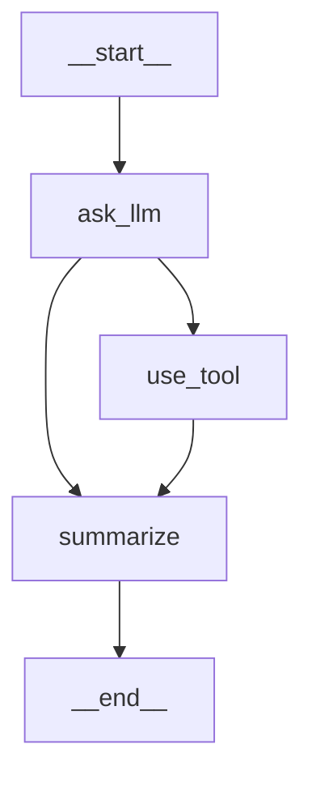

# 可视化与调试

LangGraph 提供了丰富的可视化和调试工具，帮助开发者理解图的执行流程、定位问题和优化性能。从 Mermaid 图表到 LangSmith 追踪，从状态检查到流式调试，本章涵盖所有你需要的调试技能。

## 一、图可视化

### 1.1 获取图的 Mermaid 表示

LangGraph 编译后的图对象提供了 `get_graph()` 方法，可以生成 Mermaid 格式的图表描述：

```python
from typing import TypedDict
from langchain_openai import ChatOpenAI
from langgraph.graph import StateGraph, START, END

class State(TypedDict):
    question: str
    answer: str
    tool_result: str

def ask_llm(state: State) -> dict:
    """调用 LLM"""
    llm = ChatOpenAI(model="gpt-4o-mini", temperature=0)
    response = llm.invoke(state["question"])
    return {"answer": response.content}

def use_tool(state: State) -> dict:
    """使用工具"""
    return {"tool_result": "工具执行结果"}

def summarize(state: State) -> dict:
    """总结"""
    return {"answer": f"总结: {state['tool_result']}"}

# 构建图
builder = StateGraph(State)
builder.add_node("ask_llm", ask_llm)
builder.add_node("use_tool", use_tool)
builder.add_node("summarize", summarize)

builder.add_edge(START, "ask_llm")
builder.add_conditional_edges("ask_llm", lambda s: "use_tool" if "工具" in s.get("answer", "") else "summarize")
builder.add_edge("use_tool", "summarize")
builder.add_edge("summarize", END)

graph = builder.compile()

# 获取图对象
graph_obj = graph.get_graph()

# 生成 Mermaid 文本表示
mermaid_text = graph_obj.draw_mermaid()
print(mermaid_text)
```

输出的 Mermaid 文本类似：



### 1.2 将 Mermaid 图表保存为文件

```python
# 保存 Mermaid 文本到文件
mermaid_text = graph.get_graph().draw_mermaid()

with open("graph_diagram.mmd", "w", encoding="utf-8") as f:
    f.write(mermaid_text)

# 可以在以下工具中渲染：
# - https://mermaid.live （在线编辑器）
# - VS Code 的 Mermaid 插件
# - Obsidian 的 Mermaid 插件
# - GitHub Markdown 原生支持
```

### 1.3 生成 PNG 图片

```python
# 生成 PNG 图片（需要安装额外依赖）
# pip install ipython pillow

# 方法 1：使用 draw_png()（如果有 pyppeteer 或 playwright）
try:
    png_bytes = graph.get_graph().draw_png()
    with open("graph_diagram.png", "wb") as f:
        f.write(png_bytes)
    print("PNG 图片已保存")
except Exception as e:
    print(f"生成 PNG 失败: {e}")

# 方法 2：使用 Mermaid CLI（推荐）
# npm install -g @mermaid-js/mermaid-cli
# mmdc -i graph_diagram.mmd -o graph_diagram.png
```

### 1.4 在 Jupyter Notebook 中显示

```python
# 在 Jupyter 中直接显示图
from IPython.display import Image, display

# 显示 PNG
png_data = graph.get_graph().draw_png()
display(Image(png_data))

# 或者使用 Mermaid 渲染（需要 jupyter-contrib-nbextensions）
from IPython.display import Markdown
display(Markdown(f"```mermaid\n{mermaid_text}\n```"))
```

### 1.5 自定义 Mermaid 样式

```python
# draw_mermaid() 支持自定义样式参数
mermaid_text = graph.get_graph().draw_mermaid(
    # 节点样式
    node_colors={
        "ask_llm": "#ff6b6b",
        "use_tool": "#4ecdc4",
        "summarize": "#45b7d1",
    },
    # 是否包含起始和结束节点
    with_styles=True,
)
```

### 1.6 获取图的结构信息

```python
# 获取图对象
graph_obj = graph.get_graph()

# 获取所有节点
nodes = graph_obj.nodes
print("图中的节点:")
for node in nodes:
    print(f"  - {node.name}: {node}")

# 获取图的 JSON 表示
json_repr = graph_obj.to_json()
print(f"\n图的 JSON 表示:\n{json_repr}")

# 获取带数据的 JSON（包含节点元数据）
json_with_data = graph_obj.to_json_with_data()
```

## 二、LangSmith 集成

### 2.1 配置 LangSmith

LangSmith 是 LangChain 官方的追踪和监控平台，可以自动记录 LangGraph 的每一步执行：

```python
import os

# 设置 LangSmith 环境变量
os.environ["LANGCHAIN_TRACING_V2"] = "true"
os.environ["LANGCHAIN_API_KEY"] = "your-langsmith-api-key"
os.environ["LANGCHAIN_PROJECT"] = "my-langgraph-project"  # 项目名称
os.environ["LANGCHAIN_ENDPOINT"] = "https://api.smith.langchain.com"  # 默认端点
```

### 2.2 追踪自动生效

配置好环境变量后，LangGraph 的执行会自动被追踪，无需修改代码：

```python
# 以下代码的执行会被自动记录到 LangSmith
result = graph.invoke(
    {"question": "什么是 LangGraph?"},
    config={"configurable": {"thread_id": "debug-001"}}
)

# 在 LangSmith 仪表板中可以看到：
# - 每个节点的执行时间
# - 输入/输出数据
# - LLM 调用的 token 用量
# - 工具调用的参数和结果
# - 完整的执行链路
```

### 2.3 自定义追踪元数据

```python
# 通过 config 传递自定义元数据
result = graph.invoke(
    {"question": "你好"},
    config={
        "configurable": {
            "thread_id": "debug-002",
        },
        "metadata": {
            "user_id": "user-123",
            "session_type": "production",
            "version": "v1.2.0",
            "feature_flag": "new_routing_enabled",
        },
        "tags": ["production", "user-facing"],
    }
)
```

### 2.4 在节点中添加自定义 Span

```python
from langsmith import traceable

@traceable(name="自定义处理步骤")
def custom_processing(input_text: str) -> str:
    """
    使用 @traceable 装饰器标记自定义处理步骤
    这会在 LangSmith 中创建独立的 Span
    """
    # 处理逻辑
    result = input_text.upper()
    return result

def my_node(state: State) -> dict:
    """节点中使用自定义追踪"""
    result = custom_processing(state["question"])
    return {"answer": result}
```

### 2.5 LangSmith 本地自托管

```python
# 如果使用本地部署的 LangSmith
os.environ["LANGCHAIN_TRACING_V2"] = "true"
os.environ["LANGCHAIN_API_KEY"] = "your-local-api-key"
os.environ["LANGCHAIN_ENDPOINT"] = "http://localhost:1984"  # 本地端点
os.environ["LANGCHAIN_PROJECT"] = "local-dev"
```

## 三、状态检查

### 3.1 使用 get_state() 查看当前状态

```python
from langgraph.checkpoint.memory import MemorySaver

checkpointer = MemorySaver()
graph = builder.compile(checkpointer=checkpointer)

config = {"configurable": {"thread_id": "inspect-001"}}

# 执行图
result = graph.invoke(
    {"question": "你好", "answer": "", "tool_result": ""},
    config=config
)

# 获取最终状态
state = graph.get_state(config)

print(f"状态值: {state.values}")
print(f"下一步: {state.next}")
print(f"配置: {state.config}")
print(f"创建时间: {state.created_at}")
print(f"父配置: {state.parent_config}")
```

### 3.2 get_state() 返回的 Snapshot 对象

```python
# Snapshot 对象包含丰富的信息
snapshot = graph.get_state(config)

# 核心属性
print(f"values: {snapshot.values}")          # 当前状态值
print(f"next: {snapshot.next}")              # 下一步要执行的节点元组
print(f"config: {snapshot.config}")          # 当前配置
print(f"metadata: {snapshot.metadata}")      # 元数据
print(f"created_at: {snapshot.created_at}")  # 创建时间戳
print(f"parent_config: {snapshot.parent_config}")  # 父状态配置

# 判断图是否执行完毕
if snapshot.next == ():
    print("图已执行完毕")
else:
    print(f"等待执行: {snapshot.next}")
```

### 3.3 查看状态历史

```python
# 获取完整的状态历史
history = list(graph.get_state_history(config))

print(f"共 {len(history)} 个状态快照:")
for i, snapshot in enumerate(history):
    print(f"\n--- 步骤 {i} ---")
    print(f"  节点: {snapshot.next}")
    print(f"  时间: {snapshot.created_at}")
    print(f"  值: {snapshot.values}")

# 获取特定时间点的状态
target_config = history[2].config
past_state = graph.get_state(target_config)
print(f"\n步骤 2 的状态: {past_state.values}")
```

### 3.4 带时间过滤的状态历史

```python
# 获取某个时间点之前的所有状态
from datetime import datetime

# 获取最近 5 个状态
recent_history = list(graph.get_state_history(config, limit=5))

# 遍历状态历史（用于调试）
for snapshot in graph.get_state_history(config):
    if "error" in str(snapshot.values):
        print(f"发现错误状态: {snapshot.config}")
        print(f"  值: {snapshot.values}")
        break
```

## 四、流式调试

### 4.1 使用 stream 模式逐步观察执行

```python
# 流式执行：逐步观察每个节点的输入输出
for event in graph.stream(
    {"question": "什么是机器学习?"},
    config={"configurable": {"thread_id": "stream-debug-001"}},
    stream_mode="values",  # 输出每个步骤的完整状态值
):
    print(f"--- 新状态 ---")
    for key, value in event.items():
        print(f"  {key}: {value}")
```

### 4.2 不同的 stream_mode

```python
# stream_mode="updates"：只输出每个节点的状态更新
for event in graph.stream(
    {"question": "你好"},
    config={"configurable": {"thread_id": "stream-debug-002"}},
    stream_mode="updates",
):
    # event 是字典，键是节点名，值是该节点的状态更新
    for node_name, update in event.items():
        print(f"节点 [{node_name}] 更新:")
        for key, value in update.items():
            print(f"  {key}: {value}")

# stream_mode="values"：输出每个步骤的完整状态
for event in graph.stream(
    {"question": "你好"},
    config={"configurable": {"thread_id": "stream-debug-003"}},
    stream_mode="values",
):
    print(f"完整状态: {event}")

# stream_mode="debug"：最详细的调试信息
for event in graph.stream(
    {"question": "你好"},
    config={"configurable": {"thread_id": "stream-debug-004"}},
    stream_mode="debug",
):
    print(f"调试信息: {event}")
```

### 4.3 stream_mode 对比

| stream_mode | 输出内容 | 适用场景 |
|-------------|----------|----------|
| `"values"` | 每步完整状态 | 观察状态变化全貌 |
| `"updates"` | 每步状态增量 | 关注每个节点做了什么 |
| `"debug"` | 详细执行信息 | 深入排查执行问题 |

### 4.4 自定义调试回调

```python
def debug_callback(event: dict):
    """自定义调试回调函数"""
    event_type = event.get("type", "unknown")

    if event_type == "task":
        print(f"[开始] 节点: {event.get('name', 'unknown')}")
    elif event_type == "task_result":
        print(f"[完成] 节点: {event.get('name', 'unknown')}")
        print(f"  结果: {event.get('result', {})}")
    elif event_type == "task_error":
        print(f"[错误] 节点: {event.get('name', 'unknown')}")
        print(f"  错误: {event.get('error', 'unknown')}")

# 使用回调（通过 stream 实现）
for event in graph.stream(
    {"question": "你好"},
    config={"configurable": {"thread_id": "callback-debug-001"}},
    stream_mode="debug",
):
    debug_callback(event)
```

## 五、日志配置

### 5.1 启用 LangGraph 调试日志

```python
import logging

# 配置日志级别
logging.basicConfig(
    level=logging.DEBUG,     # 最详细的日志
    format='%(asctime)s - %(name)s - %(levelname)s - %(message)s',
    datefmt='%Y-%m-%d %H:%M:%S'
)

# 只启用 LangGraph 的调试日志（其他库保持 INFO）
logging.getLogger("langgraph").setLevel(logging.DEBUG)
logging.getLogger("langchain").setLevel(logging.INFO)
logging.getLogger("httpx").setLevel(logging.WARNING)  # 减少 HTTP 日志噪音

logger = logging.getLogger(__name__)
```

### 5.2 在节点中添加日志

```python
import logging

logger = logging.getLogger(__name__)

def instrumented_node(state: State) -> dict:
    """
    带详细日志的节点
    """
    logger.info(f"[instrumented_node] 开始执行")
    logger.debug(f"[instrumented_node] 输入状态: {state}")

    try:
        # 执行业务逻辑
        result = process(state["question"])

        logger.info(f"[instrumented_node] 执行成功")
        logger.debug(f"[instrumented_node] 结果: {result}")

        return {"answer": result}

    except Exception as e:
        logger.error(f"[instrumented_node] 执行失败: {e}", exc_info=True)
        raise
```

### 5.3 性能日志

```python
import time
import logging

logger = logging.getLogger(__name__)

def timed_node(state: State) -> dict:
    """带性能计时的节点"""
    start_time = time.perf_counter()

    # 执行逻辑
    result = expensive_operation(state)

    elapsed = time.perf_counter() - start_time
    logger.info(f"[timed_node] 执行耗时: {elapsed:.3f}s")

    return {"result": result}
```

## 六、常见调试模式

### 6.1 节点未执行

```python
"""
问题：某个节点没有被执行
排查步骤：
"""

# 1. 检查图的连接
graph_obj = graph.get_graph()
print(graph_obj.draw_mermaid())
# 查看 Mermaid 图，确认边是否正确连接

# 2. 检查条件边的返回值
def debug_route(state: State) -> str:
    """调试版路由函数"""
    result = actual_route(state)
    print(f"[路由] 状态: {state}")
    print(f"[路由] 路由结果: {result}")
    return result

# 3. 检查节点名称是否匹配
builder.add_conditional_edges("node_a", debug_route, {
    "option_1": "node_b",  # 确保名称完全匹配
    "option_2": "node_c",
})

# 4. 使用 stream_mode="debug" 查看详细执行过程
for event in graph.stream(input, stream_mode="debug"):
    print(event)
```

### 6.2 状态更新丢失

```python
"""
问题：节点返回的状态更新没有生效
排查步骤：
"""

# 1. 检查节点返回值
def debug_node(state: State) -> dict:
    result = {"key": "value"}
    print(f"[debug_node] 返回: {result}")
    return result

# 2. 检查状态类型定义
class State(TypedDict):
    # 确保字段名称与返回字典的键完全匹配
    key: str       # 正确
    # ky: str      # 拼写错误会导致更新丢失

# 3. 检查 reducer 函数
from typing import Annotated

def my_reducer(current: list, update: list) -> list:
    """自定义 reducer"""
    print(f"[reducer] 当前: {current}, 更新: {update}")
    return current + update

class State(TypedDict):
    items: Annotated[list, my_reducer]

# 4. 使用 stream_mode="updates" 观察每步更新
for event in graph.stream(input, stream_mode="updates"):
    for node_name, update in event.items():
        print(f"节点 {node_name} 更新: {update}")
```

### 6.3 无限循环

```python
"""
问题：图陷入无限循环
排查步骤：
"""

# 1. 设置较低的 recursion_limit 快速发现问题
try:
    result = graph.invoke(input, config={"recursion_limit": 10})
except Exception as e:
    print(f"递归超限: {e}")

# 2. 使用 stream 观察循环模式
step_count = 0
for event in graph.stream(input, stream_mode="updates"):
    step_count += 1
    print(f"步骤 {step_count}: {event}")
    if step_count > 20:
        print("检测到可能的无限循环！")
        break

# 3. 检查条件边的逻辑
# 确保循环有明确的退出条件
def safe_route(state: State) -> str:
    iteration = state.get("iteration", 0)

    # 安全检查：防止无限循环
    if iteration > 10:
        return "end"

    if some_condition(state):
        return "continue"
    return "end"
```

### 6.4 LLM 输出不符合预期

```python
"""
问题：LLM 的输出格式与预期不符
排查步骤：
"""

def debug_llm_node(state: State) -> dict:
    """调试版 LLM 节点"""
    llm = ChatOpenAI(model="gpt-4o-mini", temperature=0)

    # 1. 记录发送给 LLM 的完整 prompt
    messages = state["messages"]
    print(f"[LLM 输入] 消息数量: {len(messages)}")
    for msg in messages:
        print(f"  {msg.type}: {msg.content[:100]}...")

    # 2. 调用 LLM
    response = llm.invoke(messages)

    # 3. 记录 LLM 的原始输出
    print(f"[LLM 输出] {response.content}")
    print(f"[LLM 输出] 类型: {type(response.content)}")
    print(f"[LLM 输出] 长度: {len(response.content)}")

    # 4. 检查是否有工具调用
    if hasattr(response, "tool_calls") and response.tool_calls:
        print(f"[LLM 工具调用] {response.tool_calls}")

    return {"messages": [response]}
```

## 七、高级调试技巧

### 7.1 断点调试

```python
# 在条件边中设置断点
def route_with_breakpoint(state: State) -> str:
    """带断点的路由函数"""
    # 在这里设置断点（IDE 或 breakpoint()）
    import pdb; pdb.set_trace()  # 标准调试器

    # 或者使用 breakpoint()（Python 3.7+）
    # breakpoint()

    if state.get("answer"):
        return "end"
    return "retry"
```

### 7.2 状态快照对比

```python
def compare_states(state1: dict, state2: dict):
    """对比两个状态的差异"""
    all_keys = set(state1.keys()) | set(state2.keys())

    for key in sorted(all_keys):
        val1 = state1.get(key, "<不存在>")
        val2 = state2.get(key, "<不存在>")

        if val1 != val2:
            print(f"差异 [{key}]:")
            print(f"  旧值: {val1}")
            print(f"  新值: {val2}")

# 使用：对比两个时间点的状态
history = list(graph.get_state_history(config))
if len(history) >= 2:
    compare_states(history[-1].values, history[-2].values)
```

### 7.3 图执行分析器

```python
import time
from collections import defaultdict

class GraphProfiler:
    """图执行性能分析器"""

    def __init__(self):
        self.node_times = defaultdict(list)
        self.current_node = None
        self.start_time = None

    def analyze(self, graph, input_data, config=None):
        """分析图执行性能"""
        config = config or {}

        for event in graph.stream(
            input_data,
            config=config,
            stream_mode="debug",
        ):
            if event[0] == "task":
                self.current_node = event[1].get("name", "unknown")
                self.start_time = time.perf_counter()

            elif event[0] == "task_result":
                if self.start_time:
                    elapsed = time.perf_counter() - self.start_time
                    self.node_times[self.current_node].append(elapsed)

    def report(self):
        """输出性能报告"""
        print("\n=== 图执行性能报告 ===")
        for node, times in self.node_times.items():
            avg = sum(times) / len(times)
            print(f"  {node}:")
            print(f"    调用次数: {len(times)}")
            print(f"    平均耗时: {avg:.3f}s")
            print(f"    最大耗时: {max(times):.3f}s")
            print(f"    最小耗时: {min(times):.3f}s")

# 使用
profiler = GraphProfiler()
profiler.analyze(graph, {"question": "你好"})
profiler.report()
```

### 7.4 可视化状态变化动画

```python
"""
在 Jupyter Notebook 中创建状态变化动画
"""
from IPython.display import display, clear_output
import time

def animate_execution(graph, input_data, config):
    """动画展示图执行过程"""
    for event in graph.stream(input_data, config=config, stream_mode="values"):
        clear_output(wait=True)

        print("=" * 50)
        print("当前状态快照")
        print("=" * 50)

        for key, value in event.items():
            if isinstance(value, str) and len(value) > 100:
                value = value[:100] + "..."
            print(f"  {key}: {value}")

        print("=" * 50)
        time.sleep(0.5)  # 暂停以便观察
```

## 八、完整调试工作流示例

```python
"""
完整调试工作流示例：构建、可视化、追踪、调试一个 Agent
"""
import os
import logging
from typing import TypedDict
from langchain_openai import ChatOpenAI
from langgraph.graph import StateGraph, START, END
from langgraph.checkpoint.memory import MemorySaver

# 1. 配置环境
os.environ["LANGCHAIN_TRACING_V2"] = "true"
os.environ["LANGCHAIN_PROJECT"] = "debug-demo"

# 2. 配置日志
logging.basicConfig(level=logging.INFO)
logger = logging.getLogger(__name__)

# 3. 定义状态
class DebugState(TypedDict):
    question: str
    answer: str
    tool_used: bool
    iteration: int

# 4. 定义节点
def think_node(state: DebugState) -> dict:
    """思考节点"""
    logger.info(f"[think] 问题: {state['question']}")
    llm = ChatOpenAI(model="gpt-4o-mini", temperature=0)
    response = llm.invoke(state["question"])
    return {
        "answer": response.content,
        "iteration": state.get("iteration", 0) + 1,
    }

def tool_node(state: DebugState) -> dict:
    """工具节点"""
    logger.info(f"[tool] 使用工具处理")
    return {"tool_used": True}

def route_node(state: DebugState) -> str:
    """路由节点"""
    if state.get("tool_used"):
        return "end"
    if state.get("iteration", 0) >= 3:
        return "end"
    return "tool"

# 5. 构建图
builder = StateGraph(DebugState)
builder.add_node("think", think_node)
builder.add_node("tool", tool_node)

builder.add_edge(START, "think")
builder.add_conditional_edges("think", route_node, {
    "tool": "tool",
    "end": END,
})
builder.add_edge("tool", "think")

# 6. 编译（带 checkpointer）
checkpointer = MemorySaver()
graph = builder.compile(checkpointer=checkpointer)

# 7. 可视化
print("=== 图结构 ===")
print(graph.get_graph().draw_mermaid())

# 8. 执行并调试
config = {"configurable": {"thread_id": "debug-full-001"}}

print("\n=== 执行过程 ===")
for event in graph.stream(
    {"question": "什么是 LangGraph?", "answer": "", "tool_used": False, "iteration": 0},
    config=config,
    stream_mode="updates",
):
    for node_name, update in event.items():
        print(f"节点 [{node_name}][[: {update}")

# 9. 检查最终状态
print("\n=== 最终状态 ===")
final_state = graph.get_state(config)
print(f"值: {final_state.values}")
print(f"下一步: {final_state.next}")

# 10. 查看执行历史
print("\n=== 执行历史 ===")
for i, snapshot in enumerate(graph.get_state_history(config)):
    print(f"步骤 {i}: next={snapshot.next}")
```

## 总结

| 工具/方法 | 用途 | 使用方式 |
|-----------|------|----------|
| `draw_mermaid()` | 生成图结构图 | `graph.get_graph().draw_mermaid()` |
| `draw_png()` | 生成 PNG 图片 | `graph.get_graph().draw_png()` |
| LangSmith | 全链路追踪 | 设置环境变量 |
| `get_state()` | 查看当前状态 | `graph.get_state(config)` |
| `get_state_history()` | 查看状态历史 | `graph.get_state_history(config)` |
| `stream(stream_mode="updates")` | 逐步观察执行 | 迭代 stream 输出 |
| `stream(stream_mode="debug")` | 详细调试信息 | 迭代 stream 输出 |
| `logging` | 自定义日志 | 在节点中添加日志 |

## 相关文档

- [[langgraph/modules/langgraph_core/StateGraph|StateGraph 详解]]
- [[langgraph/modules/langgraph_core/编译与执行|编译与执行]]
- [[langgraph/modules/langgraph_core/错误处理与恢复|错误处理与恢复]]
