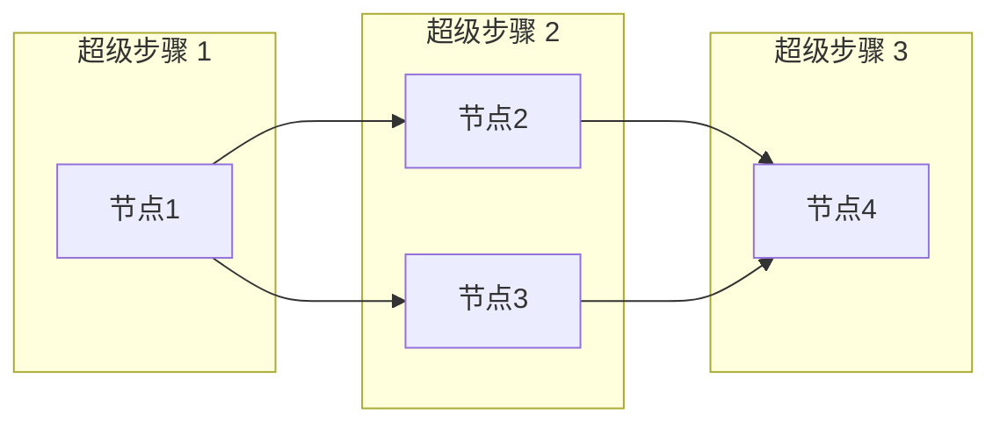
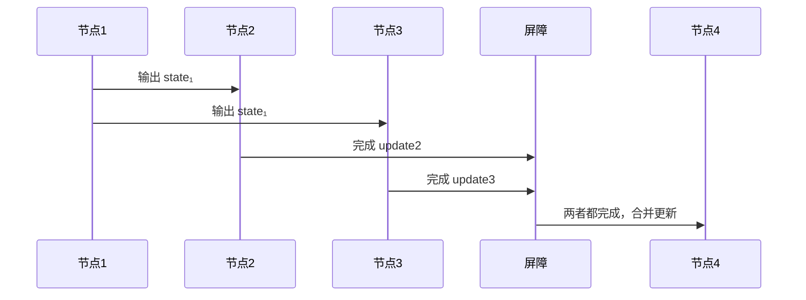
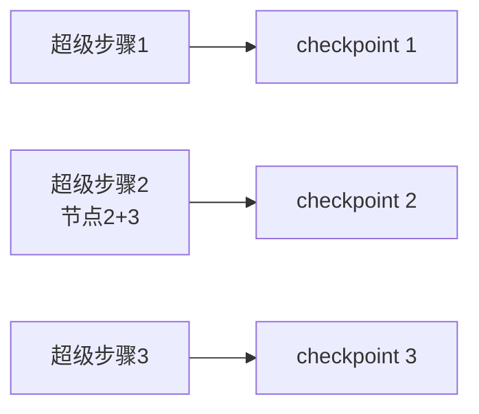

# 并行执行模型

当图中一个节点同时指向多个下游节点时（如 `Command(goto=[...])` 或条件边分发），这些下游节点构成一个**并行分支**。本文回答三个核心问题：并行节点同时执行吗？调用的是异步操作吗？有什么先后顺序？

## 一、核心概念：超级步骤（Superstep）

LangGraph 的执行模型来自 Google 的 **Pregel 图计算模型**。执行单位是"超级步骤"——**一轮并行执行的节点集合**：



| 超级步骤 | 包含节点 | 说明 |
|---------|---------|------|
| 1 | 节点1 | 串行入口 |
| 2 | 节点2 + 节点3 | **同一超级步骤 = 语义并行** |
| 3 | 节点4 | 合并两个分支的输出 |

## 二、同一超级步骤的三个关键特性

### 2.1 共享同一个输入快照

并行节点（节点2、节点3）都读到**同一个** `state₁`（节点1 的输出），**互不看到对方的更新**：

```
state₁ = {messages: [节点1的消息]}
    │
    ├── 节点2 读 state₁ → 产出 {update2}
    ├── 节点3 读 state₁ → 产出 {update3}   ← 读不到 update2！
    │
    ▼
节点4 收到: merge(state₁, update2, update3)
```

### 2.2 屏障同步（Barrier）

超级步骤内**所有节点都执行完**，才进入下一步。节点4 必须等节点2 和节点3 **全部完成**：



### 2.3 输出统一合并

屏障之后，LangGraph 把超级步骤内所有节点的更新**合并**到状态（`merge(state₁, update2, update3)`），再传给下一个超级步骤。

## 三、关键问题：物理上同时执行吗？

**"并行"首先是图语义（parallel edges），是否真并发取决于运行模式。**

### 情况 A：`graph.invoke()`（同步）→ 顺序执行

```python
result = graph.invoke(input)
# 内部：单线程逐个执行同一超级步骤的节点
#   1. 执行节点2 → 暂存 update2
#   2. 执行节点3 → 暂存 update3   ← 但节点3 读的还是 state₁，不是节点2 改过的
#   3. 屏障：两者都完成
#   4. 合并 update2 + update3 → 进入节点4
```

**物理上是一个接一个跑，但结果等价并行**——因为并行节点互不依赖、互不可见，顺序执行不改变结果。

### 情况 B：`graph.ainvoke()`（异步 + async 节点）→ 真并发

```python
async def node2(state):
    await some_io()   # async 节点
    ...

async def node3(state):
    await some_io()
    ...

result = await graph.ainvoke(input)
# 内部：asyncio 把节点2 和节点3 一起调度
# 节点2 遇到 await 让出控制权 → 节点3 开始跑 → 交替推进
# 总耗时 ≈ max(节点2, 节点3)，而不是节点2 + 节点3
```

**这是真正的并发**：两个节点的 I/O 等待时间重叠，总耗时从"相加"变成"取最大"。

### 对比总结

| 维度 | `invoke()` 同步 | `ainvoke()` 异步 |
|------|:---:|:---:|
| 物理执行 | 顺序（单线程） | 真并发（asyncio） |
| 结果语义 | 等价并行 | 等价并行 |
| 适用节点 | CPU 计算 | I/O 型（LLM/HTTP/DB） |
| 两节点各 2 秒耗时 | 4 秒 | 2 秒 |

### 简短可运行示例：并行分支 + 计时对比

一个节点分叉到两个"耗时 1 秒"的节点，再汇合——用 `invoke()` 和 `ainvoke()` 各跑一次对比耗时：

```python
import asyncio, time
from typing import TypedDict
from langgraph.graph import StateGraph, START, END

class State(TypedDict):
    total: int

def node_a(state: State) -> dict:
    return {"total": state["total"] + 1}

def node_b(state: State) -> dict:
    time.sleep(1)          # 模拟 1 秒耗时
    return {"total": state["total"] + 1}

def node_c(state: State) -> dict:
    time.sleep(1)          # 模拟 1 秒耗时
    return {"total": state["total"] + 1}

def node_d(state: State) -> dict:
    return {"total": state["total"] + 1}

builder = StateGraph(State)
builder.add_node("A", node_a)
builder.add_node("B", node_b)
builder.add_node("C", node_c)
builder.add_node("D", node_d)
builder.add_edge(START, "A")
builder.add_edge("A", "B")     # A → B、C 并行
builder.add_edge("A", "C")
builder.add_edge("B", "D")     # B、C → D（屏障后合并）
builder.add_edge("C", "D")
builder.add_edge("D", END)
graph = builder.compile()

# 同步 invoke：B、C 顺序执行 → 约 2 秒
t0 = time.time()
print(graph.invoke({"total": 0}))   # {"total": 4}
print(f"invoke  耗时: {time.time()-t0:.2f}s")

# 异步 ainvoke：B、C 真并发 → 约 1 秒
async def run_async():
    t0 = time.time()
    result = await graph.ainvoke({"total": 0})
    print(f"ainvoke 耗时: {time.time()-t0:.2f}s")
    return result

asyncio.run(run_async())
# 输出对比：invoke ≈ 2.0s，ainvoke ≈ 1.0s（B、C 的 sleep 重叠）
```

## 四、什么时候用哪种？

| 场景 | 建议 | 原因 |
|------|------|------|
| 节点是普通 CPU 计算 | `invoke()` | 真并发也无收益 |
| 节点涉及 I/O（LLM 调用、HTTP、数据库） | `ainvoke()` + async 节点 | I/O 等待重叠，耗时减半 |
| FastAPI 服务端 | 必须 `ainvoke()` | 不阻塞事件循环 |

## 五、与 Checkpointer 的关系：快照按超级步骤存

每个超级步骤结束，checkpointer 存一次完整状态快照——**checkpoint 粒度是超级步骤，不是单个节点**：



上面 4 个节点 + 3 个超级步骤 ≈ 3 条快照（而非 4 条）。这也解释了为什么 Agent 循环中"每一轮 think → act → observe 消耗 2-3 个超级步骤"。

## 六、相关页面

- [[langgraph/modules/langgraph_core/Command与状态更新]] — `Command(goto=[...])` 并行路由语法
- [[langgraph/modules/langgraph_core/错误处理与恢复]] — 超级步骤与 `recursion_limit`
- [[langgraph/modules/langgraph_streaming/异步流式]] — asyncio 并发用法
- [[langgraph/concepts/图计算范式]] — 图计算模型总览
